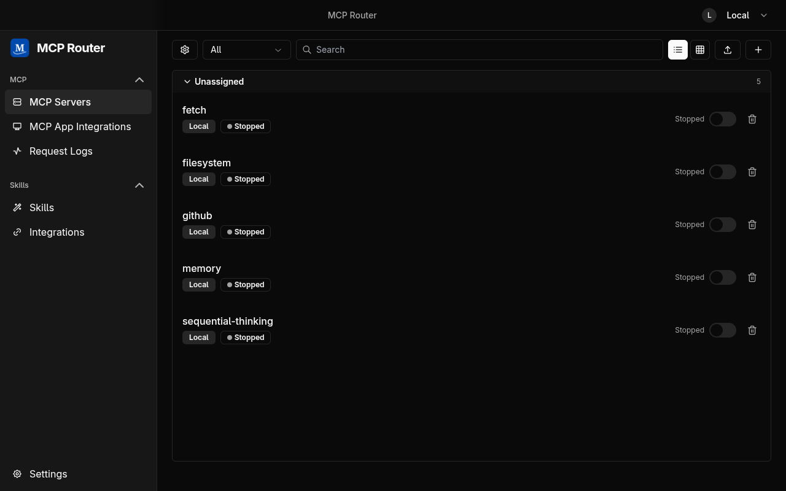
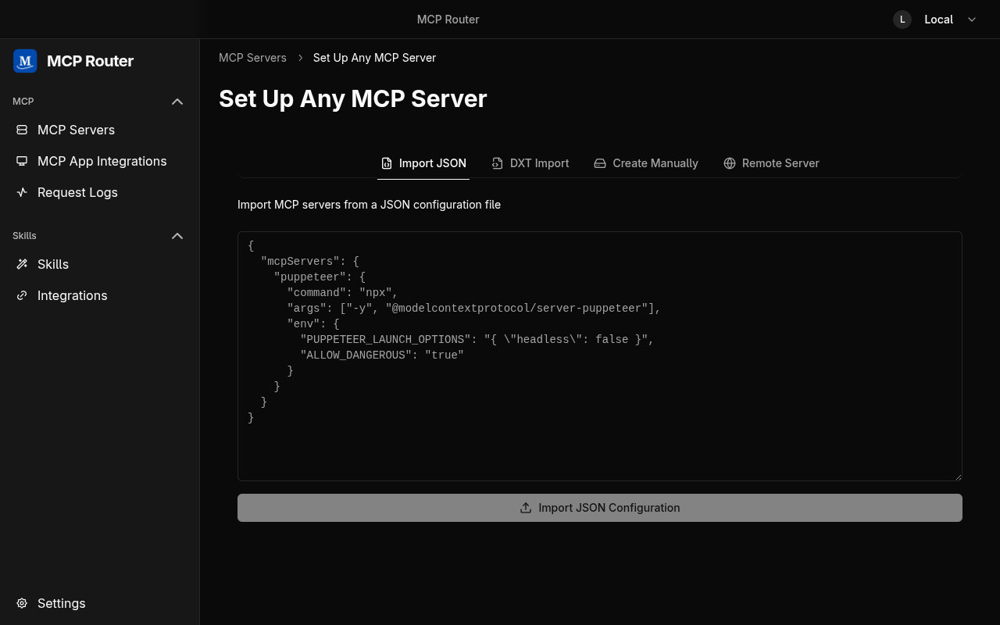
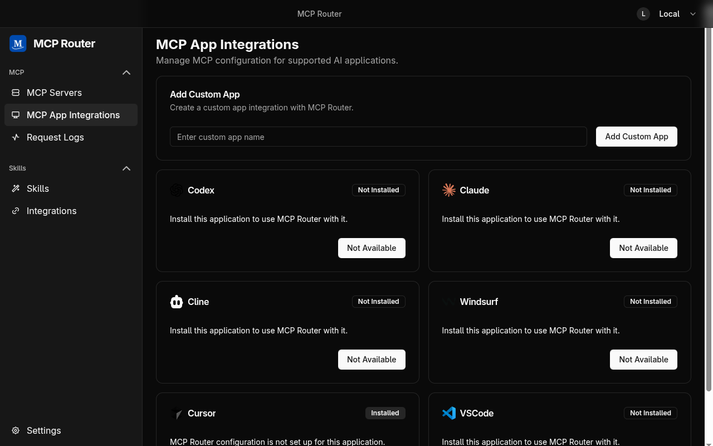
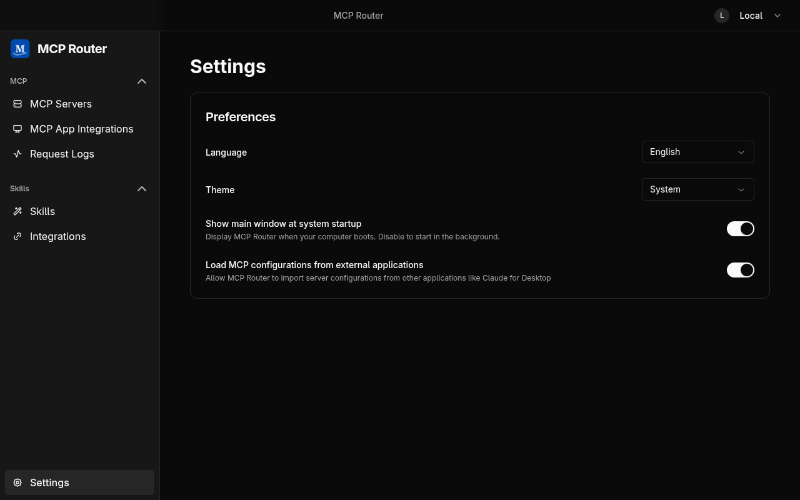

# MCP Router for Linux (unofficial patch)

A Linux build of [MCP Router](https://github.com/mcp-router/mcp-router), a desktop app for managing
Model Context Protocol (MCP) servers in one place and connecting them to AI clients.

> [!NOTE]
> This is an **unofficial, personal patch** of
> [mcp-router/mcp-router](https://github.com/mcp-router/mcp-router), based on its final release
> (v0.6.4). The original project ended support on 2026-09-18 and only ever shipped for macOS and
> Windows. This fork is not affiliated with or endorsed by the original authors, and is maintained for
> personal, non-commercial use only.

## What works

Only the local features. The original cloud service (sign-in, sync, billing) has been shut down, and the
final release already disables it along with auto-updates.

- Add local (stdio) and remote MCP servers, and toggle servers and individual tools on or off
- Organize servers into Projects and Workspaces
- Connect clients to the router (Claude Desktop, Cursor, Windsurf, Cline, VS Code, Codex, or any custom client)
- Request logs and usage stats

<details>
<summary><strong>Screenshots</strong> (Linux, Wayland)</summary>

<br>

**MCP servers**



**Adding a server** (JSON import, DXT, manual or remote)



**Client integrations**



**Settings**



</details>

## Install from a release

Download `mcp-router-<version>-linux-x64.tar.gz` from
[Releases](https://github.com/jubeater/mcp-router/releases), then:

```bash
tar -xzf mcp-router-*-linux-x64.tar.gz
cd mcp-router-*-linux-x64
./install.sh
```

Prebuilt for x86_64 and needs glibc 2.34 or newer (Ubuntu 22.04+, Debian 12+, Fedora 35+, Arch).
On anything else, build from source.

> [!TIP]
> On **Windows or macOS**, use the original's signed final release instead:
> [mcp-router v0.6.4](https://github.com/mcp-router/mcp-router/releases/tag/v0.6.4). This fork only
> builds and tests Linux.

## Build and install from source

Requirements: Node.js 20+, pnpm 10, and a C/C++ toolchain with Python (for the `better-sqlite3` and
`argon2` native modules).

```bash
git clone -b linux-port https://github.com/jubeater/mcp-router.git
cd mcp-router
pnpm install
pnpm turbo run build --filter='./packages/*'
pnpm --filter @mcp_router/electron run package
tools/linux/install.sh
```

Then launch **MCP Router** from your app menu, or run `mcp-router`.

`install.sh` installs for the current user only:

| What              | Where                                            |
| ----------------- | ------------------------------------------------ |
| App files         | `~/.local/share/mcp-router/app/`                 |
| Command           | `~/.local/bin/mcp-router`                        |
| Menu entry        | `~/.local/share/applications/mcp-router.desktop` |
| Icon              | `~/.local/share/icons/hicolor/512x512/apps/`     |
| `mcpr://` handler | registered with `xdg-mime`                       |

**Update:** quit the app (tray → Quit), then run `install.sh` from a newer release, or pull, rebuild
with the commands above, and run `tools/linux/install.sh` again.

**Uninstall:** `install.sh --uninstall` (from a release or `tools/linux/`). Your settings and server data in
`~/.config/MCP Router/` are kept; delete that folder too for a full removal.

## Connecting a client

Add a custom app in MCP Router to get a token, then point your client at the router:

```bash
export MCPR_TOKEN="mcpr_your_token"
npx -y @mcp_router/cli connect                    # all servers
npx -y @mcp_router/cli connect --project <name>   # one project
```

## Linux notes

- **Start at login:** MCP Router always adds itself to autostart
  (`~/.config/autostart/mcp-router.desktop`), as the original does on macOS and Windows. With
  "show window on startup" off, it starts hidden in the tray. Deleting the file only lasts until the
  next launch.
- **Saved secrets:** tokens are encrypted with your system keyring through the Secret Service API
  (gnome-keyring, KeePassXC, or KWallet). On desktops Chromium doesn't recognize (niri, sway,
  Hyprland, ...), the app selects this backend itself; without it, tokens would be stored unencrypted.
  To choose a backend yourself, launch with `--password-store=<backend>`.
- **Tray:** needs a system tray (StatusNotifierItem), e.g. Waybar's tray module on tiling compositors.

## Changes from the original

All Linux changes are on the `linux-port` branch; `main` is the original final release, unchanged.

- **Build:** pnpm hoisting config moved into `pnpm-workspace.yaml` (pnpm 10 ignores `.npmrc` for it,
  and Electron Forge won't build without it); the Linux binary is named `mcp-router`; `desktopName`
  is set so the window, launcher and `mcpr://` handler share one identity.
- **Install:** added `tools/linux/install.sh`.
- **Start at login:** writes an XDG autostart entry, since Electron's login-item API does nothing on Linux.
- **`mcpr://` links:** a link that launches the app is now handled, not only links sent to a running app.
- **Secrets:** selects the Secret Service keyring on unrecognized desktops (see above).

## License

The original code is licensed under the Sustainable Use License, which still applies to this patch; see
[LICENSE.md](LICENSE.md). In short: personal or internal use and modification are allowed, and
distribution is allowed only free of charge for non-commercial purposes. All original license and
copyright notices are kept unchanged.
